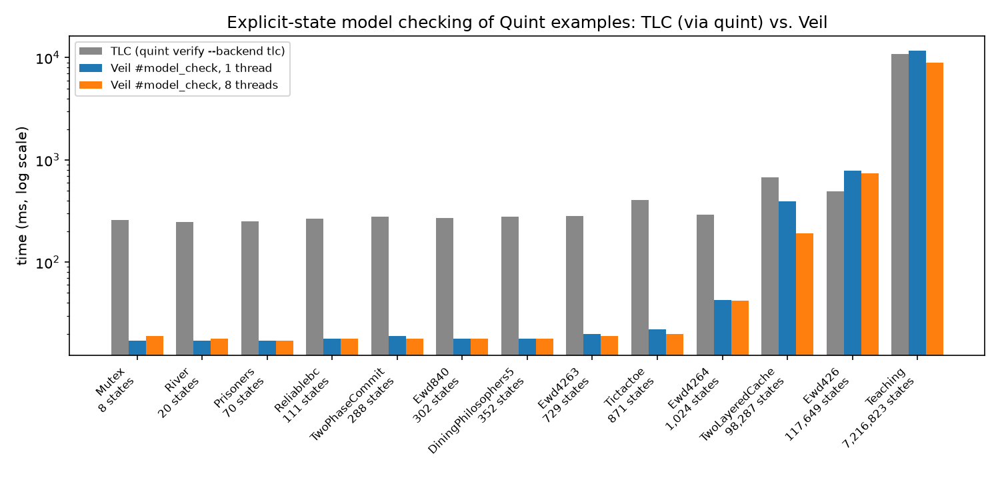

# Quint examples in Veil

This folder holds all 77 example specifications of
[Quint](https://github.com/quint-co/quint) (`examples/` at commit
[`07d7a1a`](https://github.com/quint-co/quint/tree/07d7a1a69c2093b5bc656caf3b5dfefa0d766cd0/examples)),
checked with Veil through its **Quint frontend**: a Lean file contains the Quint modules as Quint
text, and Veil elaborates each module with state into a Veil module that its model checkers,
simulator, symbolic bounded model checker and proof tools work on.

```lean
module

public import Veil.Quint

module two_phase_commit_3 {
  import two_phase_commit(resourceManagers = Set("rm1", "rm2", "rm3")).*
}

quint_invariant consistencyInv   -- quint ... --invariant=consistencyInv
#gen_spec
#quint_verify { } { }            -- quint verify --backend tlc
end two_phase_commit_3
```

```
[ok] No violation found (288 distinct states, 95ms).
```

<!-- TOC -->
- [Reading the files](#reading-the-files)
- [How Quint's checks map to Veil](#how-quints-checks-map-to-veil)
- [Agreement with Quint](#agreement-with-quint)
- [Beyond Quint: proofs for every instance](#beyond-quint-proofs-for-every-instance)
- [Performance](#performance)
- [Index of the examples](#index-of-the-examples)
- [What the frontend does not cover](#what-the-frontend-does-not-cover)
- [Regenerating and rechecking](#regenerating-and-rechecking)

## Reading the files

Each Lean file corresponds to one `.qnt` file (same folder structure, names in PascalCase, e.g.
`classic/distributed/TwoPhaseCommit/two_phase_commit.qnt` is
[Classic/Distributed/TwoPhaseCommit/TwoPhaseCommit.lean](Classic/Distributed/TwoPhaseCommit/TwoPhaseCommit.lean)).
Its header links the Quint source. Below the header is the Quint text, unchanged except for two
lexical rewrites that Lean's tokenizer needs (done by
[scripts/quint2veil.py](../../scripts/quint2veil.py)):

- comments `//` and `/* */` are written `--` and `/- -/`;
- a method called on a numeral is written `(0).to(10)` instead of `0.to(10)`.

After a module come the Veil checks for it, then `end <module>`. Where a check needs a smaller
instance than Quint's (for example, `nondet amount = 0.to(MAX_UINT).oneOf()` in the coin
contract), the file contains a copy of the module that differs only in the substitutions listed
next to it, and the checks run on the copy.

The frontend itself is in [Veil/Frontend/Quint](../../Veil/Frontend/Quint); the
[`quint-to-veil` skill](../../.agents/skills/quint-to-veil/SKILL.md) describes how to bring other
Quint specifications into Veil and what the frontend does not translate.

## How Quint's checks map to Veil

| Quint | Veil | Veil tool |
| --- | --- | --- |
| `quint verify --backend tlc` | `#quint_verify { } { }` | explicit-state model checker (Lace, `#model_check`) |
| `quint verify --max-steps=k` (Apalache) | `quint_bmc k inv` | symbolic bounded model checker (SMT), for SMT-friendly state |
| | `#quint_verify { } { } (maxDepth := k)` | explicit-state search to depth `k`, for any state |
| `quint verify --inductive-invariant=I` (Apalache) | `#check_invariants` | SMT, or `quint_grind` for every verification condition |
| `quint run --max-samples=n --max-steps=k` | `#quint_run { } { } (numTraces := n) (maxSteps := k)` | random simulation (`#simulate`) |
| `quint verify --backend tlc --temporal=p` | `#quint_temporal [p] { } { }` | Lasso (verified LTL model checking), on the frontend's translation of the `temporal` definitions |
| `quint test` | `#quint_test M` | explicit-state model checking of every execution of each `...Test` run; pure `run`s also become `#guard` checks |
| `--invariant=a,b` | `quint_invariant a, b` | |
| `--init=I --step=N` | `set_option quint.init "I"`, `set_option quint.step "N"` | |

`#quint_verify` and `#quint_run` run `#model_check` and `#simulate` with the same arguments and add
a report in Quint's format to the infoview, next to Veil's own message and trace widget:

```
An example execution:

[State 0]
{
  bowl: Set("Gabriela", "Igor", "Jure", "Shon", "Thomas"),
  gabrielas_memory: Map(),
  last_draw: Ok,
  recipient_for_santa: Map()
}

[State 1]
{
  bowl: Set("Gabriela", "Igor", "Jure", "Shon"),
  gabrielas_memory: Map(),
  last_draw: Self("Thomas"),
  recipient_for_santa: Map("Thomas" -> "Thomas")
}
...
[violation] Found an issue (393ms).
  violates: inv
```

A property that is expected to fail (as Quint's own comments say) is checked with
`set_option veil.violationIsError false in`, so that the violation is reported without failing
the build.

## Agreement with Quint

[scripts/quint_compliance.py](../../scripts/quint_compliance.py) runs Quint's TLC backend
(`quint verify --backend tlc`, quint 0.33.1, Java 21) and Veil on every example with a finite
state space, and compares the verdicts and the number of distinct reachable states. The frontend
encodes Quint states one-to-one (sets and maps are extensional), so the counts must be equal.

All 20 instances agree:

| Instance | Invariants | TLC (through Quint) | Veil | Agree |
| --- | --- | --- | --- | --- |
| `two_phase_commit_3` | consistencyInv | holds, 288 states | holds, 288 states | yes |
| `teaching` | correctness | holds, 7,216,823 states | holds, 7,216,823 states | yes |
| `mutex` | correctness, inv | holds, 8 states | holds, 8 states | yes |
| `ewd840_3` | TypeOK, Inv, TerminationDetection | holds, 302 states | holds, 302 states | yes |
| `ewd426` | – | holds, 117,649 states | holds, 117,649 states | yes |
| `ewd426_3` | – | holds, 729 states | holds, 729 states | yes |
| `ewd426_4` | – | holds, 1,024 states | holds, 1,024 states | yes |
| `DiningPhilosophers5` | TypeOk, Safety | holds, 352 states | holds, 352 states | yes |
| `reliablebc` | – | holds, 111 states | holds, 111 states | yes |
| `two_layered_cache` | – | holds, 98,287 states | holds, 98,287 states | yes |
| `BinSearch10` | – | holds, 5 states | holds, 5 states | yes |
| `river` | safety | holds, 20 states | holds, 20 states | yes |
| `prisoners3` | safetyInv, countInv | holds, 70 states | holds, 70 states | yes |
| `tictactoe` | inv | holds, 871 states | holds, 871 states | yes |
| `secret_santa` | inv | violated | violated | yes |
| `rock_paper_scissors` | winInv | holds, 19 states | holds, 19 states | yes |
| `hello` | – | holds, 3 states | holds, 3 states | yes |
| `booleans` | – | holds, 2 states | holds, 2 states | yes |
| `weakFairness` | – | holds, 2 states | holds, 2 states | yes |
| `strongFairness` | – | holds, 4 states | holds, 4 states | yes |

Temporal properties agree as well: [tlc_temporal.json](tlc_temporal.json) records TLC's
verdicts (`quint verify --backend tlc --temporal=p`) on the temporal properties of the finite
examples, and `#quint_temporal` reaches the same verdict on each of the 22 that the frontend
translates (weak and strong fairness, dining philosophers, the three `ewd426` variants, `ewd840`,
tic-tac-toe, prisoners), violations included.

Verdicts also agree where only one side can explore the full state space: Quint's simulator and
Veil both find the violations of `correct_game_status` in `play_mafia` (which Quint's TLC
backend cannot translate, as `init` is called from `step`) and of `agreement` in `badValues`;
both find no violation of `consistencyInv` in the modular two-phase commit (288 states, like the
monolithic one).

## Beyond Quint: proofs for every instance

Quint's tools check one instance at a time: TLC and the simulator explore the states of fixed
constants, and Apalache unrolls a bounded number of steps or checks an inductive invariant for
fixed constants. In Veil a Quint constant can stay a parameter, and an invariant can be proved for
all its values.

[Classic/Distributed/TwoPhaseCommit/TwoPhaseCommitProof.lean](Classic/Distributed/TwoPhaseCommit/TwoPhaseCommitProof.lean)
proves `consistencyInv` of the two-phase commit for **every set of resource managers**. The
Quint module is unchanged; seven Veil invariants strengthen `consistencyInv` to an inductive
invariant, and all 36 verification conditions (initialization and three actions, nine
invariants each) are discharged by `quint_grind`, Lean's `grind` with the frontend's lemmas about
Quint sets and maps. The result is a Lean proof (no SMT solver is trusted); it checks in about
five seconds.

## Performance



Time to check each finite instance completely (MacBook, 18 cores; the minimum of three TLC runs
and one Veil run per thread count):

- **TLC**: the time `quint verify --backend tlc` reports for the check. It includes starting
  TLC's JVM, but not quint's translation of the spec to TLA+ through Apalache (about 3.3 s more
  wall time per run).
- **Veil**: the wall time of the compiled model checker that `#model_check` builds (with
  [scripts/bench-model-check.py](../../scripts/bench-model-check.py)), including its start-up but
  not building it (5 to 10 s per spec, once).

| Instance | States | TLC (ms) | Veil, 1 thread (ms) | Veil, 8 threads (ms) |
| --- | ---: | ---: | ---: | ---: |
| `two_phase_commit_3` | 288 | 277 | 22 | 20 |
| `teaching` | 7,216,823 | 10,654 | 11,369 | 8,935 |
| `mutex` | 8 | 249 | 21 | 19 |
| `ewd840_3` | 302 | 276 | 22 | 19 |
| `ewd426` | 117,649 | 477 | 821 | 741 |
| `ewd426_3` | 729 | 269 | 37 | 22 |
| `ewd426_4` | 1,024 | 287 | 48 | 41 |
| `DiningPhilosophers5` | 352 | 278 | 22 | 21 |
| `reliablebc` | 111 | 266 | 22 | 25 |
| `two_layered_cache` | 98,287 | 672 | 386 | 193 |
| `river` | 20 | 243 | 22 | 20 |
| `prisoners3` | 70 | 233 | 21 | 19 |
| `tictactoe` | 871 | 403 | 26 | 21 |

On small state spaces Veil's native checker answers in about 20 ms, where TLC needs about
250 ms, mostly JVM start-up. On the large ones both explore millions of states per second:
`teaching` (7.2 million states) takes 10.7 s with TLC and 11.4 s (one thread) or 8.9 s (eight
threads) with Veil; `two_layered_cache` is faster in Veil, `ewd426` in TLC.

Reproduce with [scripts/bench-model-check.py](../../scripts/bench-model-check.py) on copies of
the files that use `#model_check`, then
[scripts/quint_benchmark.py](../../scripts/quint_benchmark.py), which times TLC and draws the
plot; the raw numbers are in [benchmark.json](benchmark.json).

## Index of the examples

Each row lists the Veil checks in the Lean file with their results, and Quint's reference: the
TLC run of the compliance check, and the status on Quint's own
[dashboard](https://github.com/quint-co/quint/tree/07d7a1a69c2093b5bc656caf3b5dfefa0d766cd0/examples#dashboard)
(`quint test`, and `quint verify --max-steps=3` with Apalache). "elaborates" means that the file
contains Quint modules without state or that are only used by other files, and no Veil check.

| Quint example | Lean file | Veil checks and results | Quint reference |
| --- | --- | --- | --- |
| `classic/distributed/Bakery/bakery.qnt` | [Classic/Distributed/Bakery/Bakery.lean](Classic/Distributed/Bakery/Bakery.lean) | ✅ model checking, depth ≤ 5: 2,464 states<br>✅ simulation: 1000 traces | Quint dashboard: test N/A, Apalache verify ✅ |
| `classic/distributed/ClockSync/clockSync6.qnt` | [Classic/Distributed/ClockSync/ClockSync6.lean](Classic/Distributed/ClockSync/ClockSync6.lean) | ✅ model checking, depth ≤ 4: 1,250 states<br>✅ simulation: 1000 traces | Quint dashboard: test N/A, Apalache verify ✅ |
| `classic/distributed/ConsensusAlgorithm/ConsensusAlg.qnt` | [Classic/Distributed/ConsensusAlgorithm/ConsensusAlg.lean](Classic/Distributed/ConsensusAlgorithm/ConsensusAlg.lean) | ✅ simulation: 1000 traces<br>❌ simulation: violates agreement (expected) | Quint dashboard: test ✅, Apalache verify ❌ |
| `classic/distributed/ConsensusAlgorithm/KSetAgreementConsensus.qnt` | [Classic/Distributed/ConsensusAlgorithm/KSetAgreementConsensus.lean](Classic/Distributed/ConsensusAlgorithm/KSetAgreementConsensus.lean) | elaborates | Quint dashboard: test ✅, Apalache verify ❌ |
| `classic/distributed/DiningPhilosophers/DiningPhilosophers5.qnt` | [Classic/Distributed/DiningPhilosophers/DiningPhilosophers5.lean](Classic/Distributed/DiningPhilosophers/DiningPhilosophers5.lean) | ✅ model checking: 352 states | TLC `DiningPhilosophers5`: 352 states, holds<br>Quint dashboard: test N/A, Apalache verify ✅ |
| `classic/distributed/LamportMutex/LamportMutex.qnt` | [Classic/Distributed/LamportMutex/LamportMutex.lean](Classic/Distributed/LamportMutex/LamportMutex.lean) | ✅ model checking, depth ≤ 12: 61,720 states<br>✅ simulation: 1000 traces | Quint dashboard: test N/A, Apalache verify ✅ |
| `classic/distributed/Paxos/Paxos.qnt` | [Classic/Distributed/Paxos/Paxos.lean](Classic/Distributed/Paxos/Paxos.lean) | ❌ model checking: violates Inv (expected) | Quint dashboard: test N/A, Apalache verify ❌ |
| `classic/distributed/Paxos/Voting.qnt` | [Classic/Distributed/Paxos/Voting.lean](Classic/Distributed/Paxos/Voting.lean) | elaborates | Quint dashboard: test N/A, Apalache verify N/A |
| `classic/distributed/ReadersWriters/ReadersWriters.qnt` | [Classic/Distributed/ReadersWriters/ReadersWriters.lean](Classic/Distributed/ReadersWriters/ReadersWriters.lean) | ✅ model checking, depth ≤ 6: 1,161,431 states<br>✅ simulation: 1000 traces | Quint dashboard: test N/A, Apalache verify ✅ |
| `classic/distributed/ReliableBroadcast/reliablebc.qnt` | [Classic/Distributed/ReliableBroadcast/Reliablebc.lean](Classic/Distributed/ReliableBroadcast/Reliablebc.lean) | ✅ model checking: 111 states | TLC `reliablebc`: 111 states, holds<br>Quint dashboard: test N/A, Apalache verify ✅ |
| `classic/distributed/TeachingConcurrency/mutex.qnt` | [Classic/Distributed/TeachingConcurrency/Mutex.lean](Classic/Distributed/TeachingConcurrency/Mutex.lean) | ✅ model checking: 8 states | TLC `mutex`: 8 states, holds<br>Quint dashboard: test N/A, Apalache verify ✅ |
| `classic/distributed/TeachingConcurrency/teaching.qnt` | [Classic/Distributed/TeachingConcurrency/Teaching.lean](Classic/Distributed/TeachingConcurrency/Teaching.lean) | ✅ model checking: 7,216,823 states | TLC `teaching`: 7,216,823 states, holds<br>Quint dashboard: test N/A, Apalache verify ✅ |
| `classic/distributed/TwoLayeredCache/two_layered_cache.qnt` | [Classic/Distributed/TwoLayeredCache/TwoLayeredCache.lean](Classic/Distributed/TwoLayeredCache/TwoLayeredCache.lean) | ✅ model checking: 98,287 states | TLC `two_layered_cache`: 98,287 states, holds<br>Quint dashboard: test N/A, Apalache verify ✅ |
| `classic/distributed/TwoPhaseCommit/two_phase_commit.qnt` | [Classic/Distributed/TwoPhaseCommit/TwoPhaseCommit.lean](Classic/Distributed/TwoPhaseCommit/TwoPhaseCommit.lean) | ✅ model checking: 288 states | TLC `two_phase_commit_3`: 288 states, holds<br>Quint dashboard: test ✅, Apalache verify ✅ |
| `classic/distributed/TwoPhaseCommit/two_phase_commit_modules.qnt` | [Classic/Distributed/TwoPhaseCommit/TwoPhaseCommitModules.lean](Classic/Distributed/TwoPhaseCommit/TwoPhaseCommitModules.lean) | ✅ model checking: 288 states | Quint dashboard: test ❌, Apalache verify ❌ |
| `classic/distributed/ewd426/ewd426.qnt` | [Classic/Distributed/Ewd426/Ewd426.lean](Classic/Distributed/Ewd426/Ewd426.lean) | ✅ model checking: 117,649 states | TLC `ewd426`: 117,649 states, holds<br>Quint dashboard: test N/A, Apalache verify ✅ |
| `classic/distributed/ewd426/ewd426_3.qnt` | [Classic/Distributed/Ewd426/Ewd4263.lean](Classic/Distributed/Ewd426/Ewd4263.lean) | ✅ model checking: 729 states | TLC `ewd426_3`: 729 states, holds<br>Quint dashboard: test N/A, Apalache verify ✅ |
| `classic/distributed/ewd426/ewd426_4.qnt` | [Classic/Distributed/Ewd426/Ewd4264.lean](Classic/Distributed/Ewd426/Ewd4264.lean) | ✅ model checking: 1,024 states | TLC `ewd426_4`: 1,024 states, holds<br>Quint dashboard: test N/A, Apalache verify ✅ |
| `classic/distributed/ewd840/ewd840.qnt` | [Classic/Distributed/Ewd840/Ewd840.lean](Classic/Distributed/Ewd840/Ewd840.lean) | ✅ model checking: 302 states | TLC `ewd840_3`: 302 states, holds<br>Quint dashboard: test N/A, Apalache verify ✅ |
| `classic/sequential/BinSearch/BinSearch.qnt` | [Classic/Sequential/BinSearch/BinSearch.lean](Classic/Sequential/BinSearch/BinSearch.lean) | ✅ model checking: 5 states | TLC `BinSearch10`: 5 states, holds<br>Quint dashboard: test N/A, Apalache verify ✅ |
| `cosmos/bank/bank.qnt` | [Cosmos/Bank/Bank.lean](Cosmos/Bank/Bank.lean) | elaborates | Quint dashboard: test N/A, Apalache verify N/A |
| `cosmos/bank/bankTest.qnt` | [Cosmos/Bank/BankTest.lean](Cosmos/Bank/BankTest.lean) | elaborates | Quint dashboard: test ✅, Apalache verify ✅ |
| `cosmos/ics20/bank.qnt` | [Cosmos/Ics20/Bank.lean](Cosmos/Ics20/Bank.lean) | elaborates | Quint dashboard: test ✅, Apalache verify ✅ |
| `cosmos/ics20/base.qnt` | [Cosmos/Ics20/Base.lean](Cosmos/Ics20/Base.lean) | elaborates | Quint dashboard: test N/A, Apalache verify N/A |
| `cosmos/ics20/denomTrace.qnt` | [Cosmos/Ics20/DenomTrace.lean](Cosmos/Ics20/DenomTrace.lean) | elaborates | Quint dashboard: test ✅, Apalache verify ✅ |
| `cosmos/ics20/ics20.qnt` | [Cosmos/Ics20/Ics20.lean](Cosmos/Ics20/Ics20.lean) | elaborates | Quint dashboard: test ✅, Apalache verify ✅ |
| `cosmos/ics23/ics23.qnt` | [Cosmos/Ics23/Ics23.lean](Cosmos/Ics23/Ics23.lean) | elaborates | Quint dashboard: test N/A, Apalache verify ✅ |
| `cosmos/lightclient/Blockchain.qnt` | [Cosmos/Lightclient/Blockchain.lean](Cosmos/Lightclient/Blockchain.lean) | elaborates | Quint dashboard: test N/A, Apalache verify N/A |
| `cosmos/lightclient/LCVerificationApi.qnt` | [Cosmos/Lightclient/LCVerificationApi.lean](Cosmos/Lightclient/LCVerificationApi.lean) | elaborates | Quint dashboard: test N/A, Apalache verify N/A |
| `cosmos/lightclient/Lightclient.qnt` | [Cosmos/Lightclient/Lightclient.lean](Cosmos/Lightclient/Lightclient.lean) | elaborates | Quint dashboard: test N/A, Apalache verify ✅ |
| `cosmos/lightclient/typedefs.qnt` | [Cosmos/Lightclient/Typedefs.lean](Cosmos/Lightclient/Typedefs.lean) | elaborates | Quint dashboard: test N/A, Apalache verify N/A |
| `cosmos/tendermint/Tendermint.qnt` | [Cosmos/Tendermint/Tendermint.lean](Cosmos/Tendermint/Tendermint.lean) | elaborates | Quint dashboard: test N/A, Apalache verify N/A |
| `cosmos/tendermint/TendermintModels.qnt` | [Cosmos/Tendermint/TendermintModels.lean](Cosmos/Tendermint/TendermintModels.lean) | elaborates | Quint dashboard: test ✅, Apalache verify ✅ |
| `cosmos/tendermint/TendermintTest.qnt` | [Cosmos/Tendermint/TendermintTest.lean](Cosmos/Tendermint/TendermintTest.lean) | elaborates | Quint dashboard: test N/A, Apalache verify N/A |
| `cosmwasm/zero-to-hero/vote.qnt` | [Cosmwasm/ZeroToHero/Vote.lean](Cosmwasm/ZeroToHero/Vote.lean) | elaborates | Quint dashboard: test N/A, Apalache verify ✅ |
| `cryptography/hashes/hashes.qnt` | [Cryptography/Hashes/Hashes.lean](Cryptography/Hashes/Hashes.lean) | elaborates | Quint dashboard: test N/A, Apalache verify N/A |
| `cryptography/hashes/hashesTest.qnt` | [Cryptography/Hashes/HashesTest.lean](Cryptography/Hashes/HashesTest.lean) | elaborates | Quint dashboard: test ✅, Apalache verify N/A |
| `cryptography/utxo/utxo.qnt` | [Cryptography/Utxo/Utxo.lean](Cryptography/Utxo/Utxo.lean) | elaborates | Quint dashboard: test ✅, Apalache verify ✅ |
| `games/mafia_werewolf/play_mafia.qnt` | [Games/MafiaWerewolf/PlayMafia.lean](Games/MafiaWerewolf/PlayMafia.lean) | ❌ model checking, depth ≤ 3: violates correct_game_status (expected)<br>❌ simulation: violates correct_game_status (expected) | Quint dashboard: test N/A, Apalache verify ✅ |
| `games/rock_paper_scissors/play_rock_paper_scissors.qnt` | [Games/RockPaperScissors/PlayRockPaperScissors.lean](Games/RockPaperScissors/PlayRockPaperScissors.lean) | ✅ model checking: 19 states | TLC `rock_paper_scissors`: 19 states, holds<br>Quint dashboard: test N/A, Apalache verify ✅ |
| `games/secret-santa/secret_santa.qnt` | [Games/SecretSanta/SecretSanta.lean](Games/SecretSanta/SecretSanta.lean) | ❌ model checking: violates inv (expected) | TLC `secret_santa`: violated<br>Quint dashboard: test N/A, Apalache verify ✅ |
| `games/tictactoe/tictactoe.qnt` | [Games/Tictactoe/Tictactoe.lean](Games/Tictactoe/Tictactoe.lean) | ✅ model checking: 871 states | TLC `tictactoe`: 871 states, holds<br>Quint dashboard: test N/A, Apalache verify ✅ |
| `language-features/booleans.qnt` | [LanguageFeatures/Booleans.lean](LanguageFeatures/Booleans.lean) | ✅ model checking: 2 states | TLC `booleans`: 2 states, holds<br>Quint dashboard: test N/A, Apalache verify ✅ |
| `language-features/counters.qnt` | [LanguageFeatures/Counters.lean](LanguageFeatures/Counters.lean) | ✅ model checking, depth ≤ 5: 15 states<br>✅ simulation: 1000 traces | Quint dashboard: test ❌, Apalache verify ✅ |
| `language-features/generate.qnt` | [LanguageFeatures/Generate.lean](LanguageFeatures/Generate.lean) | elaborates | Quint dashboard: test N/A, Apalache verify ✅ |
| `language-features/importFrom.qnt` | [LanguageFeatures/ImportFrom.lean](LanguageFeatures/ImportFrom.lean) | elaborates | Quint dashboard: test ✅, Apalache verify ✅ |
| `language-features/imports.qnt` | [LanguageFeatures/Imports.lean](LanguageFeatures/Imports.lean) | elaborates | Quint dashboard: test N/A, Apalache verify ✅ |
| `language-features/instances.qnt` | [LanguageFeatures/Instances.lean](LanguageFeatures/Instances.lean) | elaborates | Quint dashboard: test N/A, Apalache verify ✅ |
| `language-features/instancesFrom.qnt` | [LanguageFeatures/InstancesFrom.lean](LanguageFeatures/InstancesFrom.lean) | elaborates | Quint dashboard: test N/A, Apalache verify ✅ |
| `language-features/integers.qnt` | [LanguageFeatures/Integers.lean](LanguageFeatures/Integers.lean) | ✅ model checking, depth ≤ 3: 5 states<br>✅ simulation: 1000 traces | Quint dashboard: test N/A, Apalache verify ✅ |
| `language-features/lists.qnt` | [LanguageFeatures/Lists.lean](LanguageFeatures/Lists.lean) | ✅ model checking, depth ≤ 3: 1 states<br>✅ simulation: 1000 traces | Quint dashboard: test N/A, Apalache verify ✅ |
| `language-features/maps.qnt` | [LanguageFeatures/Maps.lean](LanguageFeatures/Maps.lean) | ✅ model checking, depth ≤ 3: 5 states<br>✅ simulation: 1000 traces | Quint dashboard: test N/A, Apalache verify ✅ |
| `language-features/nondetEx.qnt` | [LanguageFeatures/NondetEx.lean](LanguageFeatures/NondetEx.lean) | ✅ model checking, depth ≤ 3: 93 states<br>✅ simulation: 1000 traces | Quint dashboard: test ✅, Apalache verify ✅ |
| `language-features/option.qnt` | [LanguageFeatures/Option.lean](LanguageFeatures/Option.lean) | ✅ model checking, depth ≤ 3: 6,057 states<br>✅ simulation: 1000 traces | Quint dashboard: test ✅, Apalache verify ✅ |
| `language-features/records.qnt` | [LanguageFeatures/Records.lean](LanguageFeatures/Records.lean) | ✅ model checking, depth ≤ 3: 2 states<br>✅ simulation: 1000 traces | Quint dashboard: test N/A, Apalache verify ✅ |
| `language-features/sets.qnt` | [LanguageFeatures/Sets.lean](LanguageFeatures/Sets.lean) | ✅ model checking, depth ≤ 3: 5 states<br>✅ simulation: 1000 traces | Quint dashboard: test N/A, Apalache verify ✅ |
| `language-features/strongFairness.qnt` | [LanguageFeatures/StrongFairness.lean](LanguageFeatures/StrongFairness.lean) | ✅ model checking: 4 states | TLC `strongFairness`: 4 states, holds<br>Quint dashboard: test N/A, Apalache verify ✅ |
| `language-features/tuples.qnt` | [LanguageFeatures/Tuples.lean](LanguageFeatures/Tuples.lean) | ✅ model checking, depth ≤ 3: 2 states<br>✅ simulation: 1000 traces | Quint dashboard: test N/A, Apalache verify ✅ |
| `language-features/weakFairness.qnt` | [LanguageFeatures/WeakFairness.lean](LanguageFeatures/WeakFairness.lean) | ✅ model checking: 2 states<br>✅ temporal: (checked 2 properties, explored 6 product states)<br>❌ temporal: Violation: liveness_failure (violates: notDoneLeadsToDoneNoFairness) | TLC `weakFairness`: 2 states, holds<br>Quint dashboard: test N/A, Apalache verify ✅ |
| `puzzles/prisoners/prisoners.qnt` | [Puzzles/Prisoners/Prisoners.lean](Puzzles/Prisoners/Prisoners.lean) | ✅ model checking: 70 states | TLC `prisoners3`: 70 states, holds<br>Quint dashboard: test N/A, Apalache verify ✅ |
| `puzzles/river/river.qnt` | [Puzzles/River/River.lean](Puzzles/River/River.lean) | ✅ model checking: 20 states | TLC `river`: 20 states, holds<br>Quint dashboard: test N/A, Apalache verify ✅ |
| `solidity/ERC20/erc20.qnt` | [Solidity/ERC20/Erc20.lean](Solidity/ERC20/Erc20.lean) | elaborates | Quint dashboard: test ✅, Apalache verify ✅ |
| `solidity/GradualPonzi/gradualPonzi.qnt` | [Solidity/GradualPonzi/GradualPonzi.lean](Solidity/GradualPonzi/GradualPonzi.lean) | elaborates | Quint dashboard: test ✅, Apalache verify ✅ |
| `solidity/SimpleAuction/SimpleAuction.qnt` | [Solidity/SimpleAuction/SimpleAuction.lean](Solidity/SimpleAuction/SimpleAuction.lean) | elaborates | Quint dashboard: test ✅, Apalache verify N/A |
| `solidity/SimplePonzi/simplePonzi.qnt` | [Solidity/SimplePonzi/SimplePonzi.lean](Solidity/SimplePonzi/SimplePonzi.lean) | elaborates | Quint dashboard: test ✅, Apalache verify ✅ |
| `solidity/icse23-fig7/lottery.qnt` | [Solidity/Icse23Fig7/Lottery.lean](Solidity/Icse23Fig7/Lottery.lean) | elaborates | Quint dashboard: test N/A, Apalache verify ❌ |
| `spells/BoundedUInt.qnt` | [Spells/BoundedUInt.lean](Spells/BoundedUInt.lean) | elaborates | Quint dashboard: test ✅, Apalache verify N/A |
| `spells/basicSpells.qnt` | [Spells/BasicSpells.lean](Spells/BasicSpells.lean) | elaborates | Quint dashboard: test ✅, Apalache verify N/A |
| `spells/commonSpells.qnt` | [Spells/CommonSpells.lean](Spells/CommonSpells.lean) | elaborates | Quint dashboard: test ✅, Apalache verify N/A |
| `spells/rareSpells.qnt` | [Spells/RareSpells.lean](Spells/RareSpells.lean) | elaborates | Quint dashboard: test ✅, Apalache verify N/A |
| `tutorials/booleans.qnt` | [Tutorials/Booleans.lean](Tutorials/Booleans.lean) | elaborates | Quint dashboard: test N/A, Apalache verify N/A |
| `tutorials/coin.qnt` | [Tutorials/Coin.lean](Tutorials/Coin.lean) | ✅ model checking, depth ≤ 3: 481,005 states<br>✅ simulation: 1000 traces | Quint dashboard: test ✅, Apalache verify ✅ |
| `tutorials/hello.qnt` | [Tutorials/Hello.lean](Tutorials/Hello.lean) | ✅ model checking: 3 states | TLC `hello`: 3 states, holds<br>Quint dashboard: test ✅, Apalache verify ✅ |
| `tutorials/integers.qnt` | [Tutorials/Integers.lean](Tutorials/Integers.lean) | elaborates | Quint dashboard: test N/A, Apalache verify N/A |
| `tutorials/repl/kettle.qnt` | [Tutorials/Repl/Kettle.lean](Tutorials/Repl/Kettle.lean) | elaborates | Quint dashboard: test N/A, Apalache verify ✅ |
| `tutorials/sets.qnt` | [Tutorials/Sets.lean](Tutorials/Sets.lean) | elaborates | Quint dashboard: test N/A, Apalache verify N/A |
| `verification/defaultOpNames.qnt` | [Verification/DefaultOpNames.lean](Verification/DefaultOpNames.lean) | elaborates | Quint dashboard: test N/A, Apalache verify ✅ |

## What the frontend does not cover

- `#quint_test` checks *every* execution of a run, where `quint test` samples one; a test that
  passes in Quint can therefore fail in Veil (e.g. `consensusRunTest` of `properValues`). Runs that
  start with `nondet`, and the tests of the Solidity and Cosmos bank/ICS20 examples (whose actions
  range over huge integer domains), are not run.
- Temporal properties with `orKeep` or `next` (action properties), or with fairness of an action
  with parameters, are not translated; the frontend reports each one.
- Uninterpreted types (`type T` without a definition), `apalache::generate`, `fieldNames`,
  re-exports (`export M as N`), and empty collections whose element type nothing determines
  (`List()`) are not supported. The files that use them are elaborated with `quint.lenient`,
  which skips what does not elaborate and says so in a warning; their headers point this out.
- Quint's run-time errors (`get` of a missing key, `head` of `[]`) are not errors in Veil: these
  operators return the default value of their type.
- A variable that an action does not assign keeps its value in Veil; Quint reports an error.

## Regenerating and rechecking

Get Quint's examples:

```bash
git clone https://github.com/quint-co/quint /tmp/quint
```

Regenerate the Lean files of this folder from them:

```bash
python3 scripts/quint_examples.py /tmp/quint
```

Elaborate every file, which runs all the Veil checks:

```bash
scripts/quint_build_all.sh
```

Compare the results with `quint verify --backend tlc` (needs the quint CLI and Java 21):

```bash
python3 scripts/quint_compliance.py /tmp/quint
```
